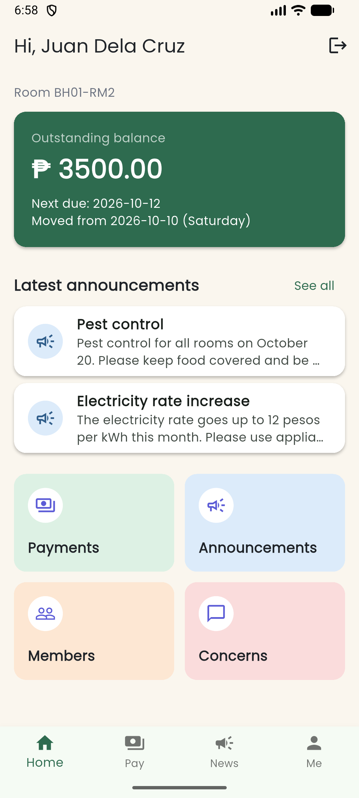
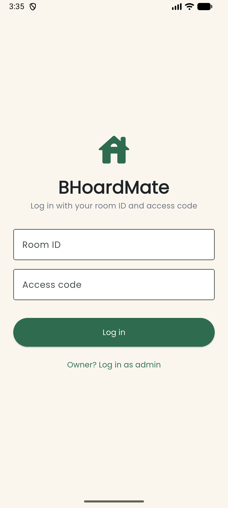
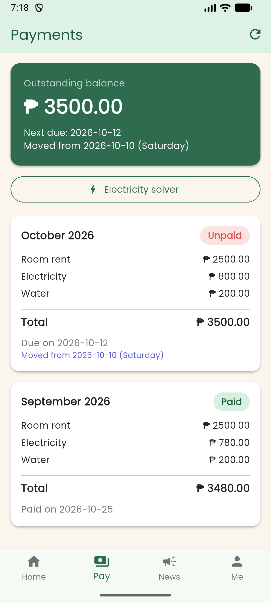
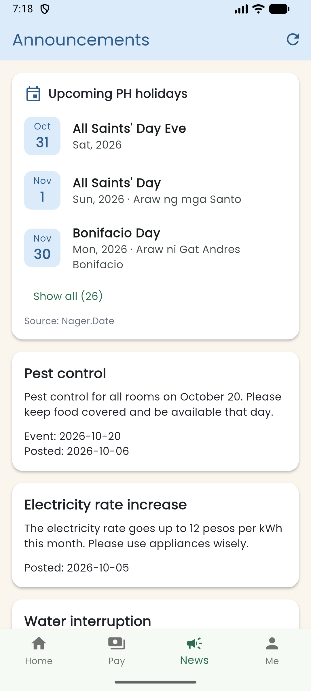

# BHoardMate

A Flutter app that helps boarding house owners and boarders track rent, split electricity bills, and share announcements and concerns in one place. A way to converge technology into our business owners' workflow for convenience, efficiency and transparency.

## Download

<p align="center">
  <a href="https://github.com/ohimeee/bhoardmate/releases/latest"></a>
</p>

<p align="center"><em>Requires Android 7.0 or higher.</em></p>

Get `BHoardMate-v1.0.0.apk` from the [latest release](https://github.com/ohimeee/bhoardmate/releases/latest) and install it on the phone (allow "Install unknown apps" for your browser or file manager). Demo boarder: `BH01-RM2` / `2222`.

## Members

SE2142 final project, Group BJ.

| Member | Responsibilities |
| --- | --- |
| Bryan Kenth F. Estoesta ([@BryWick](https://github.com/BryWick)) | Concerns, Announcements, Members/profile and Rooms screens; screen validation; icon/splash; APK build evidence; README and documentation coordination. |
| Johnmarc B. Jayme ([@ohimeee](https://github.com/ohimeee)) | Models, Firebase/Auth and security rules, providers, holiday API and due-date logic, Login/Home/Payments, navigation and shared widgets; Technical Implementation section of the paper. |

Both members contribute to Git/GitHub, review and testing.

## Features

- Owner login with email/password; boarder login with a Room ID and access code. Firebase restores an existing session when possible.
- Home shows outstanding bills and recent announcements. The owner also has a monthly rent-collected summary.
- Payments show rent, electricity, water, total, due date and payment status. Owners can add, edit, delete and mark bills paid/unpaid. The electricity solver calculates kWh × rate ÷ boarders.
- Owners create, edit and delete announcements; boarders read them. Boarders report concerns for their own room, and owners mark concerns pending/done.
- Members lets signed-in boarders view fellow boardmates and open read-only profiles. Boarders edit only their own profile; Me opens the signed-in user's profile. Owners can edit their own name/contact number and view room/member details.
- Owner-only Rooms supports adding rooms, editing rent and resetting access codes when tenants move out. Resetting clears the previous boarder's profile. Codes are stored separately from the directory and are not shown on profile screens.
- News displays Philippine public holidays from Nager.Date with loading, retry and saved-list offline states. Displayed due dates move past weekends and loaded holidays; the original bill date stays in Firestore. Missing holiday years show a warning.
- Forms include validation, lists have empty/loading/error states, and deletion requires confirmation. The app has a custom launcher icon, native splash and animated startup.

See build verification below for completed emulator checks and remaining end-to-end testing.

## Screenshots

The current release Home and login captures are shown below. All captures use the project's Medium Phone API 36.1 emulator.

| Boarder Home — release, October 26 | Login after splash — October 25 |
| --- | --- |
|  |  |

| Boarder Payments — release, October 26 | Boarder News — release, October 26 |
| --- | --- |
|  |  |

Updated owner and boarder captures from October 26:

| Screen | Owner | Boarder |
| --- | --- | --- |
| Concerns | [Owner list](docs/screenshots/screens/2026-10-26_concerns-owner.png) | [Boarder list](docs/screenshots/screens/2026-10-26_concerns-boarder.png) |
| Announcements | [Owner list](docs/screenshots/screens/2026-10-26_announcements-owner.png) | [Boarder list](docs/screenshots/screens/2026-10-26_announcements-boarder.png) |
| Members | [Directory](docs/screenshots/screens/2026-10-26_members-directory-owner.png) | [Directory](docs/screenshots/screens/2026-10-26_members-directory-boarder.png) |
| Member detail | [Detail](docs/screenshots/screens/2026-10-26_members-detail-owner.png) | [Read-only boardmate detail](docs/screenshots/screens/2026-10-26_members-detail-boardmate.png) |
| Me | [Owner profile](docs/screenshots/screens/2026-10-26_members-me-owner.png) | [Own profile](docs/screenshots/screens/2026-10-26_members-me-boarder.png) |
| Rooms | [Owner list](docs/screenshots/screens/2026-10-26_rooms-owner.png) | Owner only |

The updated captures replace the older theme/profile/Rooms views. [Owner profile editing](docs/screenshots/screens/2026-10-26_owner-edit-profile-form.png), [room reset confirmation](docs/screenshots/screens/2026-10-26_rooms-reset-confirmation.png), forms and validation captures are in [docs/screenshots/screens](docs/screenshots/screens). Icon/splash captures are in [docs/screenshots/release](docs/screenshots/release). A screenshot shows a UI state; it does not by itself verify persistence or cross-device synchronization.

## Setup and run

1. Install Git, Flutter 3.44.x stable (Dart 3.12.x), Android Studio and its Android SDK/toolchain. Run `flutter doctor` and resolve Android toolchain issues; accept SDK licenses with `flutter doctor --android-licenses`.
2. Create/start **Medium Phone API 36.1**, Google Play x86_64, 1080 × 2400. Use portrait, light mode, default font/display sizes and English for project testing and screenshots.
3. Clone and install the locked dependencies:

   ```powershell
   git clone https://github.com/ohimeee/bhoardmate.git
   cd bhoardmate
   flutter pub get
   ```

4. Coordinate Firebase/demo access with Johnmarc. The checkout includes `lib/firebase_options.dart`, `android/app/google-services.json` and `firestore.rules`; running the app still requires the corresponding Firebase project, enabled email/password and anonymous sign-in, deployed rules and provisioned demo data. A clone does not create the backend or demo accounts. Johnmarc owns Firebase configuration, rule deployment and account/data provisioning.
5. Verify the running emulator ID, then launch:

   ```powershell
   flutter devices
   flutter run -d emulator-5554
   ```

   Substitute the listed ID if it differs.

   | Demo login | Credentials |
   | --- | --- |
   | Boarder | Room ID: `BH01-RM2` · Access code: `2222` |
   | Owner | Ask the team for the owner email/password. |

Internet is needed for initial authentication and live Firebase data. Holiday offline mode uses the last successful response saved on that device.

## Packages

Direct dependencies from [pubspec.yaml](pubspec.yaml); [pubspec.lock](pubspec.lock) records the resolved versions.

| Package | Purpose |
| --- | --- |
| `provider` | Shared authentication, room, payment, announcement, concern and holiday state. |
| `firebase_core` | Firebase initialization. |
| `firebase_auth` | Owner email/password and boarder anonymous authentication. |
| `cloud_firestore` | Shared records and live snapshot streams. |
| `http` | Nager.Date holiday requests. |
| `shared_preferences` | Saves successful holiday responses by year for fallback use. |
| `google_fonts` | Poppins typography. |
| `cupertino_icons` | Flutter template icon dependency. |
| `flutter_test`, `flutter_lints` | Automated tests and analyzer rules (development). |
| `flutter_launcher_icons`, `flutter_native_splash` | Generates launcher and native splash resources (development). |

## Code and API

Screens read state with `context.watch` and perform actions through providers. `DatabaseService` owns Firestore/Auth calls, and `HolidayService` owns HTTP requests. Providers subscribe to the database streams. Shared UI includes `BalanceCard`, `EmptyState`, `InfoCard`, `StatusChip` and `FeatureButton`.

| Location | Contents |
| --- | --- |
| `lib/main.dart`, `lib/app_theme.dart` | Startup, provider registration and theme. |
| `lib/screens/` | Login, Home, Payments/form, Announcements, Concerns, Members/details, owner profile, Rooms and splash. |
| `lib/models/`, `lib/providers/` | Record parsing and shared application state. |
| `lib/services/` | Firebase and holiday requests/cache. |
| `lib/widgets/` | Reusable cards, chips, states, solver, holiday section and splash artwork. |
| `firestore.rules`, `test/` | Database access rules and automated tests. |

`MainScreen` keeps Home/Pay/News/Me in an `IndexedStack`. Other screens open with `Navigator.push` and `MaterialPageRoute`; member details receive a `Room`, and payment editing receives a `Payment` through constructors.

The holiday endpoint is `GET https://date.nager.at/api/v3/PublicHolidays/{year}/PH`. `Holiday.fromJson` parses `date`, `localName` and `name`. The public endpoint requires no API key. The provider loads the previous, current and next year independently, exposes loading/error/offline state, and falls back to saved responses when requests fail. See [HolidayService](lib/services/holiday_service.dart), [HolidayProvider](lib/providers/holiday_provider.dart) and [HolidaySection](lib/widgets/holiday_section.dart).

## Debugging case: duplicate Hero tags

[PR #45](https://github.com/ohimeee/bhoardmate/pull/45) records a navigation crash caused by the Payments and News floating action buttons sharing the default Hero tag. `MainScreen` keeps both tabs mounted in an `IndexedStack`, so buttons on different tabs can still belong to the same route.

The recorded fix sets `heroTag: null` on the Payments floating action button in [payments_screen.dart](lib/screens/payments_screen.dart), disabling its Hero participation. The tab does not need a shared-element transition. The PR reports 47 passing tests at that point; the later October 26 check passed all 82 existing tests and opened the release boarder tabs. That boarder check does not exercise the owner's floating action button path.

The before-fix picture in [PR #52](https://github.com/ohimeee/bhoardmate/pull/52) shows the failure reproduced on October 26, 2026. Running `flutter test test/login_screen_test.dart` fails at `owner switch logs in and opens Home`: the assertion and `Hero._allHeroesFor` stack frames identify duplicate default FloatingActionButton tags. The after-fix output shows all six login tests passing. This documents stack-trace debugging.

| Before the fix | After the fix |
| --- | --- |
| [Code and failure image](docs/screenshots/debugging/2026-10-26_hero-tag-crash_before.png) · [Full stack trace](docs/screenshots/debugging/2026-10-26_hero-tag-crash_before.txt) | [Code and passing-test image](docs/screenshots/debugging/2026-10-26_hero-tag-crash_after.png) · [Test output](docs/screenshots/debugging/2026-10-26_hero-tag-crash_after.txt) |

The broader October 26 check is also preserved: [analyzer](docs/screenshots/tooling/2026-10-26_flutter-analyze.txt), [formatting](docs/screenshots/tooling/2026-10-26_dart-format.txt), [82-test output](docs/screenshots/tooling/2026-10-26_flutter-test.txt) and [results image](docs/screenshots/tooling/2026-10-26_analyze-format-test.png).

## Android APK builds

Use Flutter 3.44.x, the Android SDK and the project's configured Firebase app. The builds below were checked with Flutter 3.44.9 and Dart 3.12.2. Run these commands from the repository root:

```powershell
flutter pub get
dart format --output=none --set-exit-if-changed lib test
flutter analyze
flutter test
flutter build apk --debug
flutter build apk --release
```

The formatting command checks without changing files. If it reports changes, run `dart format lib test`, review the changes and repeat the checks.

| Build | Output | Purpose |
| --- | --- | --- |
| Debug | `build/app/outputs/flutter-apk/app-debug.apk` | Development build with debugging support; Flutter run supports hot reload. |
| Release | `build/app/outputs/flutter-apk/app-release.apk` | Optimized build for installation and the course submission; no hot reload or debugger support. |

Both builds hide Flutter's DEBUG banner because `debugShowCheckedModeBanner` is false. Banner visibility does not identify the build mode. Release compilation optimizes Dart code and removes unused icons; startup and runtime speed must be measured on a device rather than inferred from APK size.

Install either APK on the required Medium Phone API 36.1 emulator (Google Play x86_64, 1080 × 2400, portrait, light mode, default font/display sizes, English):

```powershell
adb -s emulator-5554 install -r build/app/outputs/flutter-apk/app-debug.apk
adb -s emulator-5554 install -r build/app/outputs/flutter-apk/app-release.apk
```

Install one build at a time. Both use `com.bj.bhoardmate`, so the second replaces the first. `-r` retains app data when the signing certificates match. The current Gradle release configuration uses the debug signing key; this is a release-mode APK, not a separately signed production release.

Before submission, check startup, owner and boarder login, navigation, permitted CRUD actions, profile permissions, live Firebase updates, holiday loading/offline states and validation on the emulator. Use the real demo accounts supplied by Johnmarc. Upload the verified release APK to Canvas; APKs are generated under the ignored `build/` directory and are not committed to Git.

### Build verification — October 26, 2026

- Source: merged app code from main commit `89315cf`, on `feature/docs` after merging main.
- Formatting: 55 Dart files checked, zero changes required.
- Analyzer: zero issues.
- Tests: all 82 existing automated tests passed. These do not establish a complete live Firebase walkthrough.
- Debug APK: built successfully; 184,067,396 bytes (175.54 MiB).
- Release APK: built successfully; 55,462,731 bytes (52.89 MiB), 69.9% smaller than debug. Both are universal APKs from the commands above.
- APK inspection: application ID `com.bj.bhoardmate`, label `BHoardMate`, version `1.0.0` (code 1), minimum API 24 and target API 36. The release manifest includes internet permission and the installed release is not debuggable. Both APK signatures verify and use the same Android Debug certificate.
- Emulator: Medium Phone, API 36.1, Google Play x86_64, 1080 × 2400; light mode and default density/font scale verified.
- Debug installation: blocked by `INSTALL_FAILED_INSUFFICIENT_STORAGE`. Android cache trimming did not free enough space; the newly built debug APK has not been launch-tested.
- Release installation: succeeded with `adb install -r`; cold launch succeeded and restored the existing boarder session. Home, Pay, News (including holidays) and Me opened successfully. No Flutter error or fatal exception appeared in the inspected logcat window. This was a startup/navigation check, not a full owner/boarder CRUD, offline or cross-device synchronization test.
- Evidence: [release boarder Home screenshot](docs/screenshots/release/2026-10-26_release-boarder-home.png), captured directly from the emulator in portrait at 1080 × 2400.
- Submission: Canvas upload and the full owner/boarder walkthrough remain pending. No runtime speed comparison was measured.

SHA-256 checksums for these APKs:

```text
app-debug.apk   6999df1bbbc75b507beec52ad1ca5008b65b9e8c36062a4d6667b97b0512d4f6
app-release.apk f0a20982964094f8a394e5d7d1c1aeb511cf1aa6170a72b373e7111d1589406c
```

## Credits

BHoardMate uses the [Nager.Date](https://date.nager.at) public holiday API, [Firebase](https://firebase.google.com) (Cloud Firestore and Authentication) and the [Flutter](https://flutter.dev) packages listed above. The Poppins font is from [Google Fonts](https://fonts.google.com/specimen/Poppins).

Thank you to everyone who contributed to BHoardMate!

<a href="https://github.com/ohimeee/bhoardmate/graphs/contributors">
  
</a>
